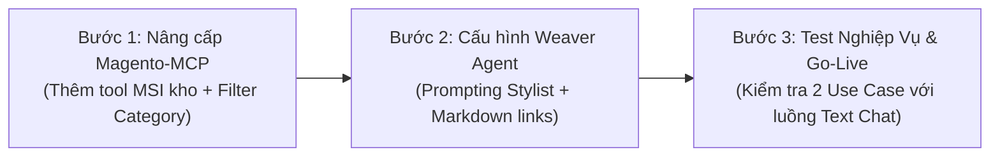

# Đánh Giá Năng Lực Magento-MCP & Kế Hoạch Triển Khai AI Shopping Assistant

Tài liệu này đánh giá chi tiết tính khả thi của bộ công cụ `magento-mcp` đối với 2 Use Case kinh doanh (Tư vấn thời trang theo phong cách và Phối đồ Outfit với AI Shopping Assistant), đồng thời phác thảo kế hoạch kỹ thuật toàn diện để tích hợp giữa **Chatbox AI v2 (Vue 3)**, **CMS Backend v2 (Strapi)**, **Weaver Agent Platform (Vision & LLM Orchestrator)** và **Magento MCP**.

---

## 1. Tổng Quan Kiến Trúc Hệ Thống

```mermaid
flowchart TD
    subgraph Client ["Client Layer (Khách hàng)"]
        WebStore["Website Thương Mại Điện Tử (Magento Storefront)"]
        IframeScript["Script nhúng: chatbox.platform.js"]
        ChatboxUI["Chatbox AI v2 (Vue 3 Widget: Text, Voice, Upload Ảnh, Carousel UI)"]
        WebStore -->|Nhúng iframe| ChatboxUI
    end

    subgraph Gateway ["API Gateway & Conversation Layer"]
        StrapiCMS["CMS Backend v2 (Strapi)"]
        WeaverService["Weaver Service (Forwarder & Session Manager)"]
        ChatboxUI -->|REST / SSE Streaming| StrapiCMS
        StrapiCMS --> WeaverService
    end

    subgraph AgentBrain ["AI Brain Layer"]
        WeaverAPI["WEAVER API Base URL"]
        VisionLLM["Multimodal Vision & Stylist LLM Agent"]
        WeaverService -->|Kèm text + image payload| WeaverAPI
        WeaverAPI --> VisionLLM
    end

    subgraph MCPIntegration ["Tooling & Data Layer"]
        MagentoMCP["magento-mcp (Go Server)"]
        MagentoAPI["Magento 2 REST API (Catalog, MSI Inventory, Sales Rules, Cart)"]
        VisionLLM -->|Model Context Protocol (MCP)| MagentoMCP
        MagentoMCP -->|REST Calls| MagentoAPI
    end

    ChatboxUI -.->|postMessage ADD_TO_CART| WebStore
```

---

## 2. Đánh Giá Khả Năng Đáp Ứng Của Magento-MCP

### 2.1. Use Case 1: Tư Vấn Sản Phẩm Theo Nhu Cầu & Phong Cách
Khách hàng mô tả nhu cầu (dịp, phong cách, ngân sách, màu sắc...) hoặc tải ảnh phong cách mẫu lên để nhận gợi ý sản phẩm phù hợp từ AI.

| Bước nghiệp vụ | Yêu cầu chức năng | Tool hiện có trong `magento-mcp` | Trạng thái & Giải pháp hoàn thiện |
| :--- | :--- | :--- | :--- |
| **01. Hiểu nhu cầu khách hàng** | Phân tích dịp (tiệc tối, công sở), màu sắc, mức ngân sách (< 2 triệu), chất liệu từ prompt hoặc ảnh. | Xử lý bởi Weaver Multimodal LLM | **Đã đáp ứng**: Weaver nhận diện intent và trích xuất entities cần thiết để gọi tool. |
| **02. Tìm kiếm & gợi ý sản phẩm** | Truy xuất sản phẩm theo phân khúc giá, loại đầm/váy, trạng thái kích hoạt. | `magento_list_products`<br>`magento_list_categories`<br>`magento_list_category_products` | **Đã đáp ứng 85%**: Hỗ trợ lọc `price_from`, `price_to`, `status=1`, `type_id`.<br>*Cần mở rộng*: Thêm tham số `category_id` vào searchCriteria của `magento_list_products` để lọc trực tiếp nhóm váy dạ hội/tiệc. |
| **03. So sánh & tư vấn chi tiết** | Trích xuất size, chất liệu, màu sắc, giá so sánh và giải thích lý do phù hợp. | `magento_get_product` | **Đã đáp ứng 100%**: Trả về đầy đủ thuộc tính chi tiết, configurable options (size/color), mô tả và thư viện ảnh `media_gallery_entries`. |
| **04. Hỗ trợ mua hàng & phụ kiện** | - Gợi ý phụ kiện đi kèm (giày cao gót, túi xách, khuyên tai).<br>- Thao tác thêm vào giỏ hàng. | `magento_get_related_products` (`link_type="crosssell"`)<br>`magento_create_empty_cart`<br>`magento_add_cart_item` | **Đã đáp ứng 90%**:<br>- Tool `magento_get_related_products` đã hỗ trợ link_type `crosssell` rất tốt cho phụ kiện.<br>- Cần kết nối luồng giỏ hàng khách với Storefront qua `postMessage`. |

---

### 2.2. Use Case 3: Phối Đồ Theo Phong Cách Với AI Shopping Assistant
Khám phá phong cách, phối trọn bộ Outfit (Blazer, Quần tây, Áo sơ mi, Túi, Giày), áp dụng mã giảm giá và kiểm tra tồn kho từng showroom.

| Tính năng chính | Yêu cầu kỹ thuật | Tool hiện có trong `magento-mcp` | Trạng thái & Giải pháp |
| :--- | :--- | :--- | :--- |
| **Gợi ý Set Outfit** | Tạo set đồ hoàn chỉnh gồm sản phẩm chính và các phụ kiện hài hoà về màu sắc, kiểu dáng. | `magento_get_related_products`<br>`magento_list_products` | **Đã đáp ứng tốt**: AI chọn item chủ đạo, sau đó gọi `crosssell` hoặc search theo danh mục bổ trợ để tạo set phối đồ. |
| **Ưu đãi & Ngân sách** | Tính giá ưu đãi, hiển thị tag giảm giá (-20%, -15%), giá gốc gạch ngang và tổng giá set. | `magento_get_product`<br>`magento_list_sales_rules`<br>`magento_get_sales_rule` | **Đã đáp ứng 100%**: `magento_get_product` trả về `price` và `special_price`. Sales rules giúp AI nắm bắt quy tắc chiết khấu hiện hành. |
| **Tồn kho theo Showroom (MSI)** | Tự động kiểm tra tồn kho theo size, màu sắc tại từng cửa hàng (Vincom Đồng Khởi, Saigon Centre, Aeon Tân Phú). | `magento_list_inventory_sources`<br>`magento_get_stock_item` | **Cần bổ sung thêm 1 Tool**: Hiện có tool lấy danh sách store và tổng tồn chung. Cần thêm tool `magento_get_source_items` (gọi endpoint Magento MSI `/V1/inventory/source-items?searchCriteria...`) để kiểm tra số lượng tồn của SKU tại từng cửa hàng cụ thể. |
| **Gợi ý thay thế khi hết hàng** | Nếu showroom hết hàng hoặc kho hết size, AI đề xuất sản phẩm tương tự. | `magento_get_related_products` (`link_type="related"`) | **Đã đáp ứng 100%**: Trích xuất các sản phẩm liên quan/thay thế được liên kết trong Magento. |

---

## 3. Khoảng Trống Kỹ Thuật & Phạm Vi Tinh Gọn (Lean Scope)

Dựa trên yêu cầu thực tế của 2 Use Case:
1. **Luồng Upload Ảnh**:
   - Trong 2 kịch bản (UC1 & UC3), khách hàng tương tác hoàn toàn bằng **văn bản tự nhiên** (Text).
   - Vì vậy, **chưa cần mở rộng luồng upload ảnh ngay lúc này**. Luồng chat text hiện tại giữa `chatbox-ai-v2` $\leftrightarrow$ `cms-backend-v2` $\leftrightarrow$ `Weaver` đã thông suốt và đủ điều kiện triển khai.
2. **Giao diện Chatbox (UI Cards/Carousels)**:
   - **Tạm hoãn việc sửa code UI của `chatbox-ai-v2`**: `chatbox-ai-v2` đã tích hợp sẵn thư viện `markdown-it`, hỗ trợ hiển thị text markdown, in đậm, danh sách bullet, ảnh markdown và hyperlink clickable (`target="_blank"`).
   - Weaver chỉ cần định dạng câu trả lời Markdown đẹp mắt kèm link trực tiếp đến trang chi tiết sản phẩm (PDP) trên website Magento.
3. **Magento MCP**:
   - Hiện chỉ thiếu 1 tool chuyên biệt để kiểm tra tồn kho theo từng Showroom (Magento MSI Source Items).

---

## 4. Giải Pháp Cho Khách Hàng Chưa Đăng Nhập (Guest Cart)

### Tính Khả Thi: **100% Khả Thi**
Magento 2 hỗ trợ đầy đủ cơ chế giỏ hàng cho khách vãng lai (**Guest Cart**):
- Khi bất kỳ khách hàng nào truy cập Storefront mà chưa đăng nhập, Magento tự động khởi tạo một phiên session và cấp một **Guest Masked Quote ID** (lưu trữ trong cookie và local storage của trình duyệt).
- Khách vãng lai hoàn toàn có thể thêm sản phẩm vào giỏ hàng bình thường mà không cần đăng ký hay đăng nhập tài khoản.

### 2 Phương Án Triển Khai:

#### Phương Án 1: Direct PDP Link (Đơn giản nhất - Khuyên dùng)
- Bot gợi ý sản phẩm kèm đường link xem chi tiết: `[Xem chi tiết & Mua](https://domain.com/vay-midi-den.html)`.
- Khách bấm vào link sẽ mở trang sản phẩm trên website Magento, chọn size/màu và bấm "Thêm vào giỏ" như luồng mua hàng thông thường.
- **Ưu điểm**: Khách hàng vãng lai mua hàng 100% tự nhiên, không cần code thêm bất kỳ logic API hay đồng bộ giỏ hàng phức tạp nào.

#### Phương Án 2: Đồng Bộ Giỏ Hàng Qua `postMessage` (Nâng cao)
- Chatbox chạy trong `iframe`, khi khách yêu cầu bot thêm đồ vào giỏ hoặc click nút trên message:
  ```javascript
  window.parent.postMessage({
    type: 'DATUMBRIDGE_CHATBOX_ADD_TO_CART',
    payload: { sku: 'BLZ-01', qty: 1 }
  }, '*');
  ```
- Script `chatbox.platform.js` nhúng trên website Magento lắng nghe sự kiện này và trigger action Add-to-Cart của theme Magento (sử dụng session & `form_key` hiện hành của khách vãng lai). Sản phẩm sẽ tự động xuất hiện trong Mini-cart của trang web.

---

## 5. Kế Hoạch Triển Khai Tinh Gọn (3 Bước Cốt Lõi)



### Bước 1: Nâng Cấp Magento-MCP (Go Server)
1. **Thêm tool `magento_get_source_items`**:
   - Endpoint: `/V1/inventory/source-items?searchCriteria[filterGroups][0][filters][0][field]=sku&searchCriteria[filterGroups][0][filters][0][value]={sku}`.
   - Trả về số lượng tồn và trạng thái tại từng chi nhánh (Vincom Đồng Khởi, Saigon Centre, Aeon Tân Phú...).
2. **Mở rộng `magento_list_products`**:
   - Cho phép truyền thêm tham số `category_id` trong filter để lọc nhanh danh mục (đầm tiệc, blazer, phụ kiện).

### Bước 2: Cấu Hình Prompting & Tool Calling Trên Weaver
1. **Thiết lập System Prompt cho AI Stylist**:
   - Hướng dẫn AI cách phân tích phong cách, mức giá, dịp đi tiệc/công sở từ câu hỏi của khách.
   - Hướng dẫn quy trình gọi tools:
     - Dùng `magento_list_products` để tìm sản phẩm theo ngân sách & danh mục.
     - Dùng `magento_get_related_products` (`link_type="crosssell"`) để phối trọn set đồ (outfit).
     - Dùng `magento_get_source_items` để kiểm tra kho chi nhánh khi khách hỏi còn hàng ở đâu.
     - Dùng `magento_get_related_products` (`link_type="related"`) để gợi ý sản phẩm thay thế khi hết hàng.
2. **Định dạng Markdown Output**:
   - Hướng dẫn Weaver trả kết quả bằng Markdown sạch, đẹp: liệt kê từng món, giá gốc, giá khuyến mãi, tình trạng kho và link sản phẩm.

### Bước 3: Kiểm Thử Nghiệp Vụ & Nghiệm Thu
1. Thử nghiệm kịch bản Use Case 1: Tìm váy dạ tiệc đen thanh lịch dưới 2 triệu + gợi ý phụ kiện.
2. Thử nghiệm kịch bản Use Case 3: Gợi ý set đồ đi làm + kiểm tra tồn kho tại showroom + gợi ý món thay thế.
3. Kiểm tra tính năng mở link và thêm hàng vào giỏ đối với khách vãng lai (chưa đăng nhập).

---

## 6. Kết Luận
Với phạm vi tinh gọn này:
- **Không cần can thiệp code của `chatbox-ai-v2` và `cms-backend-v2`**.
- **Khách hàng chưa đăng nhập vẫn trải nghiệm và mua hàng hoàn toàn bình thường**.
- Thời gian triển khai được rút ngắn tối đa, chỉ tập trung vào việc hoàn thiện tool tồn kho trong **`magento-mcp`** và tinh chỉnh prompt trên **Weaver**.

