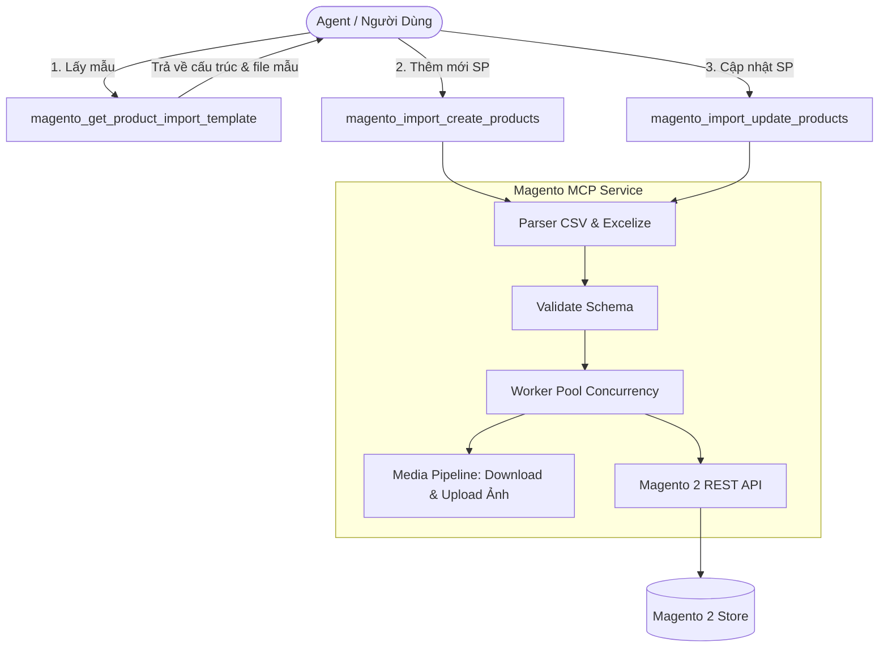
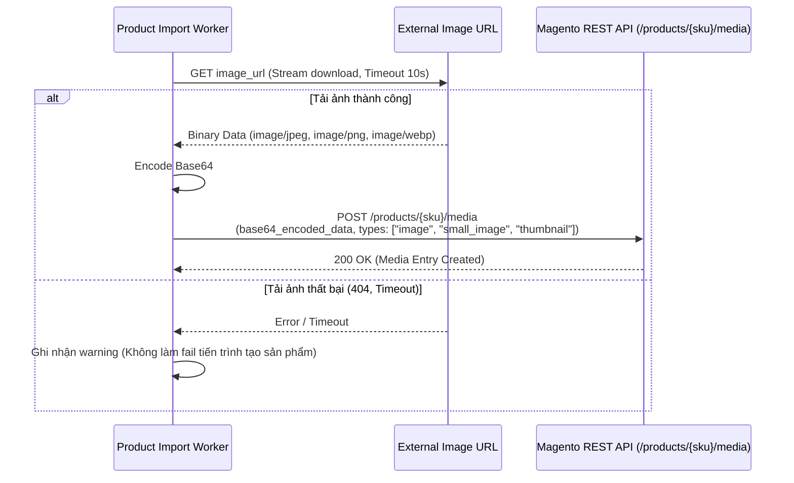

## Bộ Công Cụ MCP Import & Update Sản Phẩm Bằng Excel (.xlsx) Cho Magento 2

---

## 1. Tổng Quan & Mục Tiêu

### 1.1. Mục Tiêu
- Bổ sung vào dịch vụ `magento-mcp` (Go 1.23) khả năng xử lý **thêm mới** và **cập nhật** sản phẩm hàng loạt (bulk import) thông qua file bảng tính **Excel (`.xlsx`)**.
- Tối giản hóa tham số đầu vào cho AI Agent và người dùng: chỉ cần truyền đường dẫn file local (`file_path`).
- Hỗ trợ đầy đủ **100% chuẩn thuộc tính Magento 2** (Core attributes, Inventory, Pricing, SEO, Categories, Media Gallery, và **Dynamic Custom Attributes**).
- Cung cấp cơ chế tự động tải và upload ảnh sản phẩm từ URL (`image_url`, `additional_images`).

### 1.2. Danh Sách Tools MCP
1. `magento_get_product_import_template`: Xuất cấu trúc và dữ liệu file mẫu chuẩn Excel (.xlsx) cho thêm mới hoặc cập nhật.
2. `magento_import_create_products`: Thêm mới hàng loạt sản phẩm từ file Excel (.xlsx).
3. `magento_import_update_products`: Cập nhật thông tin hàng loạt sản phẩm hiện có từ file Excel (.xlsx).



---

## 2. Chi Tiết Đặc Tả Các Tools MCP

### 2.1. Tool 1: `magento_get_product_import_template`
*Mục đích*: Cung cấp file mẫu chuẩn xác kèm hướng dẫn và ví dụ cụ thể để người dùng hoặc AI Agent dễ dàng điền dữ liệu.

#### Tham Số Đầu Vào (Input Parameters)
```json
{
  "type": "object",
  "properties": {
    "type": {
      "type": "string",
      "enum": ["create", "update"],
      "default": "create",
      "description": "Loại file mẫu: 'create' (thêm mới sản phẩm) hoặc 'update' (cập nhật sản phẩm)."
    },
    "format": {
      "type": "string",
      "enum": ["csv", "xlsx"],
      "default": "csv",
      "description": "Định dạng file mẫu mong muốn: 'csv' hoặc 'xlsx'."
    }
  }
}
```

#### Kết Quả Trả Về (Return Payload)
- `format`: `"csv"` hoặc `"xlsx"`.
- `filename`: Tên file gợi ý (ví dụ: `magento_product_create_template.csv`).
- `csv_content`: Chuỗi CSV văn bản có sẵn dòng tiêu đề và 2 dòng ví dụ minh họa (chỉ trả về khi format = `csv`).
- `file_base64`: Chuỗi Base64 nội dung file Excel hoàn chỉnh có style định dạng (chỉ trả về khi format = `xlsx`).
- `fields_guide`: Bảng tra cứu mô tả chi tiết ý nghĩa từng cột, định dạng dữ liệu, và cột nào bắt buộc.

---

### 2.2. Tool 2: `magento_import_create_products`
*Mục đích*: Thêm mới hàng loạt sản phẩm vào danh mục Magento từ file.

#### Nguyên Tắc Nghiệp Vụ
- **Bắt buộc**: Phải có các cột `sku`, `name`, `price`.
- **Kiểm tra trùng SKU**: Nếu SKU đã tồn tại trên Magento, hệ thống sẽ **bỏ qua (skip)** hoặc ghi nhận vào danh sách lỗi (tránh việc vô tình ghi đè sản phẩm đang có).
- **Giá trị mặc định**:
  - `status`: 1 (Enabled).
  - `visibility`: 4 (Catalog & Search).
  - `type_id`: `simple`.
  - `attribute_set_id`: 4 (Default Attribute Set).

#### Tham Số Đầu Vào (Input Parameters)
```json
{
  "type": "object",
  "properties": {
    "file_path": {
      "type": "string",
      "description": "Đường dẫn file trên máy local hoặc container (hỗ trợ .xlsx)."
    }
  },
  "required": ["file_path"]
}
```

#### Kết Quả Trả Về (Return Payload)
```json
{
  "success": true,
  "summary": {
    "total_rows": 50,
    "created_count": 47,
    "failed_count": 3
  },
  "failed_items": [
    { "row": 12, "sku": "TSHIRT-01", "error": "Product with SKU 'TSHIRT-01' already exists" },
    { "row": 25, "sku": "SHOES-RED", "error": "Missing required field: price" },
    { "row": 31, "sku": "JEANS-99", "error": "Invalid price format: 'abc'" }
  ],
  "warnings": [
    { "sku": "TSHIRT-02", "warning": "Failed to download image from 'https://site.com/broken.jpg' (HTTP 404). Product created without image." }
  ]
}
```

---

### 2.3. Tool 3: `magento_import_update_products`
*Mục đích*: Cập nhật thông tin hàng loạt sản phẩm đang tồn tại trên Magento từ file.

#### Nguyên Tắc Nghiệp Vụ
- **Bắt buộc**: Duy nhất cột `sku`.
- **Cập nhật từng phần (Partial Update)**:
  - File chỉ cần chứa các cột muốn cập nhật (ví dụ: chỉ cần file gồm 2 cột `sku` và `price` để cập nhật bảng giá; hoặc `sku` và `qty` để cập nhật tồn kho).
  - Cột nào không có trong file hoặc để trống sẽ **giữ nguyên giá trị cũ** trên Magento.
- **Kiểm tra tồn tại**: Nếu SKU không tìm thấy trên Magento, ghi nhận dòng lỗi `"Product SKU not found"` và tiếp tục xử lý các dòng khác.

#### Tham Số Đầu Vào (Input Parameters)
```json
{
  "type": "object",
  "properties": {
    "file_path": {
      "type": "string",
      "description": "Đường dẫn file trên máy local hoặc container (hỗ trợ .xlsx)."
    }
  },
  "required": ["file_path"]
}
```

#### Kết Quả Trả Về (Return Payload)
```json
{
  "success": true,
  "summary": {
    "total_rows": 100,
    "updated_count": 98,
    "failed_count": 2
  },
  "failed_items": [
    { "row": 14, "sku": "UNKNOWN-SKU", "error": "Product with SKU 'UNKNOWN-SKU' not found in Magento" }
  ]
}
```

---

## 3. Quy Chuẩn Fields Toàn Diện Theo Chuẩn Magento 2 EAV

Hệ thống hỗ trợ ánh xạ tự động không phân biệt chữ hoa/thường (`SKU` = `sku` = ` Mã SKU `) với đầy đủ các nhóm thuộc tính sau:

### 3.1. Danh Sách Thuộc Tính Chi Tiết

| Nhóm | Tên Cột Trong File | Tương Ứng Trong Magento REST API | Quy Tắc & Giá Trị Hợp Lệ |
| :--- | :--- | :--- | :--- |
| **Cốt Lõi** | `sku` | `product.sku` | **Bắt buộc**. Mã duy nhất của sản phẩm. |
| | `name` | `product.name` | Bắt buộc khi tạo mới. Tên hiển thị sản phẩm. |
| | `price` | `product.price` | Bắt buộc khi tạo mới. Giá bán gốc dạng số (ví dụ: `250000`). |
| | `attribute_set_id`| `product.attribute_set_id` | Mặc định `4` (Default Attribute Set). |
| | `type_id` | `product.type_id` | Mặc định `simple`. Hỗ trợ: `simple`, `virtual`, `downloadable`. |
| | `status` | `product.status` | `1` (Enabled - Bật), `2` (Disabled - Tắt). Mặc định `1`. |
| | `visibility` | `product.visibility` | `1`: Not Visible, `2`: Catalog, `3`: Search, `4`: Catalog & Search (Mặc định). |
| | `weight` | `product.weight` | Khối lượng sản phẩm (ví dụ: `0.5`). Mặc định `0`. |
| **Tồn Kho** | `qty` | `extension_attributes.stock_item.qty` | Số lượng tồn kho (ví dụ: `100`). |
| | `is_in_stock` | `extension_attributes.stock_item.is_in_stock` | `1` (Còn hàng) hoặc `0` (Hết hàng). Tự động bật `1` nếu `qty > 0`. |
| | `manage_stock` | `extension_attributes.stock_item.manage_stock`| `1` (Có quản lý tồn kho) hoặc `0` (Không quản lý). |
| **Khuyến Mãi & Giá** | `special_price` | `custom_attributes.special_price` | Giá bán khuyến mãi (ví dụ: `199000`). |
| | `special_from_date`| `custom_attributes.special_from_date` | Ngày bắt đầu KM định dạng `YYYY-MM-DD`. |
| | `special_to_date`| `custom_attributes.special_to_date` | Ngày kết thúc KM định dạng `YYYY-MM-DD`. |
| | `cost` | `custom_attributes.cost` | Giá vốn của sản phẩm (dành cho quản lý nội bộ). |
| | `msrp` | `custom_attributes.msrp` | Giá bán lẻ đề xuất của hãng. |
| **Danh Mục & Thuế**| `categories` / `category_ids` | `extension_attributes.category_links` | Danh sách ID danh mục, phân tách bởi dấu phẩy (ví dụ: `2,15,34`). |
| | `tax_class_id` | `custom_attributes.tax_class_id` | `0`: Không thuế, `2`: Hàng chịu thuế (Taxable Goods - mặc định). |
| **Mô Tả & Nội Dung**| `short_description`| `custom_attributes.short_description` | Mô tả ngắn đầu trang sản phẩm. |
| | `description` | `custom_attributes.description` | Bài viết mô tả chi tiết sản phẩm (hỗ trợ văn bản hoặc mã HTML). |
| **SEO & Đường Dẫn**| `url_key` | `custom_attributes.url_key` | Slug URL (ví dụ: `ao-thun-nam-cotton`). Tự động sinh nếu để trống. |
| | `meta_title` | `custom_attributes.meta_title` | Tiêu đề SEO trang sản phẩm. |
| | `meta_keywords`| `custom_attributes.meta_keyword` | Từ khóa SEO. |
| | `meta_description`| `custom_attributes.meta_description`| Thẻ mô tả ngắn cho công cụ tìm kiếm. |
| **Hình Ảnh** | `image_url` / `image` | `media_gallery_entries` | URL ảnh chính. Tự gán các vai trò: `image`, `small_image`, `thumbnail`. |
| | `additional_images`| `media_gallery_entries` | Danh sách URL ảnh phụ trong album, cách nhau bằng dấu phẩy. |

### 3.2. Cơ Chế Xử Lý Dynamic Custom Attributes
Trong Magento 2, các cửa hàng luôn tạo thêm nhiều thuộc tính riêng (`color`, `size`, `brand`, `material`, `gender`,...).
- **Cơ chế**: Bất kỳ tên cột nào trong file **không** thuộc danh sách các trường chuẩn ở bảng trên sẽ được tự động gom vào mảng `custom_attributes`:
```json
{
  "custom_attributes": [
    { "attribute_code": "color", "value": "Blue" },
    { "attribute_code": "size", "value": "XL" },
    { "attribute_code": "brand", "value": "Adidas" }
  ]
}
```
Nhờ đó, người dùng có thể mở rộng file import với bất kỳ thuộc tính nào của cửa hàng mà không cần phải chỉnh sửa lại mã nguồn của MCP.

---

## 4. Kiến Trúc Xử Lý Media & Upload Ảnh (`image_url`)



- **An toàn & Chống nghẽn**:
  - Giới hạn kích thước ảnh tải về tối đa: 15MB/ảnh.
  - Timeout khi tải ảnh: 10 giây/ảnh.
  - Cơ chế **Fault Tolerance**: Nếu ảnh bị hỏng hoặc link 404, sản phẩm vẫn được tạo/sửa thành công và hệ thống ghi chú lại cảnh báo trong mục `warnings`.

---

## 5. Kiến Trúc Xử Lý Đồng Thời & Hiệu Năng (Worker Pool)

- **Worker Concurrency**: Sử dụng Go Channels và Goroutines với số lượng workers cố định (5 - 10 workers song song).
- **Tránh nghẽn Magento**: Điều tiết số lượng request đồng thời để không gây quá tải CPU/MySQL trên server Magento của khách hàng.
- **Đọc file tiết kiệm bộ nhớ**: Sử dụng `excelize.Rows()` stream reader để đọc từng dòng thay vì tải toàn bộ file 100.000 dòng vào RAM cùng một lúc.

---

## 6. Kế Hoạch Triển Khai Mã Nguồn (Implementation Plan)

### 6.1. File Mã Nguồn Dự Kiến Tạo/Sửa trong `MCP/magento-mcp/`

| File | Hành Động | Nội Dung |
| :--- | :--- | :--- |
| `go.mod` | Sửa đổi | Cài đặt dependency `github.com/xuri/excelize/v2`. |
| `internal/tools/import_parser.go` | **Tạo mới** | Module đọc file từ `file_path`, parse CSV & Excel, chuẩn hóa header. |
| `internal/tools/import_media.go` | **Tạo mới** | Module download ảnh từ URL, encode base64 và gọi API media gallery của Magento. |
| `internal/tools/import_template_tool.go` | **Tạo mới** | Triển khai tool `magento_get_product_import_template`. |
| `internal/tools/import_product_tools.go` | **Tạo mới** | Triển khai 2 tools `magento_import_create_products` và `magento_import_update_products`. |
| `internal/tools/registry.go` | Sửa đổi | Đăng ký 3 tools mới vào danh mục sản phẩm của `magento-mcp`. |
| `registry_docs/*.md` | **Tạo mới** | Tạo 3 file tài liệu chuẩn theo kiến trúc `x-datumbridge-docs`. |
| `design.md` | Sửa đổi | Cập nhật tổng số lượng tools từ 42 lên 45 tools. |

---
*Tài liệu này là đặc tả kỹ thuật chính thức làm cơ sở để tiến hành hiện thực mã nguồn.*
